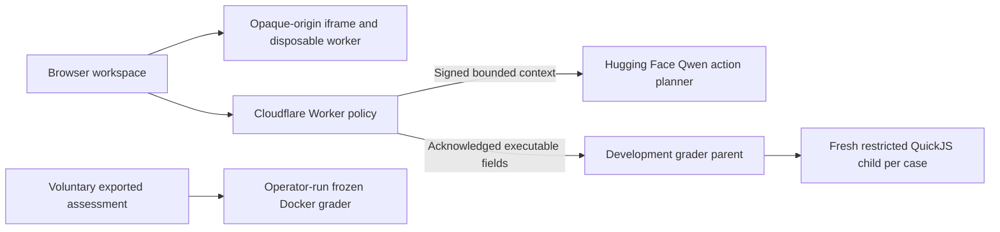

# FixFirst

**Practise the debugging work behind a defensible fix.** An open-source apprenticeship for first-time developers: reproduce a real bug, state a falsifiable hypothesis, investigate with a bounded AI mentor, repair the code, and prove a regression catches the original failure.

**Track:** Tech Employment for Youth — portfolio building and maintenance work samples.

[Open the judge walkthrough](https://fixfirst-debugging-lab.tusharaggarwal274.chatgpt.site/?task=url-join-fragment&demo=1) · [Practice lab](https://fixfirst-debugging-lab.tusharaggarwal274.chatgpt.site/) · [Development grading](https://fixfirst-debugging-lab.tusharaggarwal274.chatgpt.site/grade.html) · [Backend deployment/source](https://huggingface.co/spaces/TechTush/fixfirst-services)

## See the whole loop in three minutes

1. In the judge walkthrough, choose **Reproduce the bug**. The pinned historical `url-join` module passes 5 of 10 browser cases; fragments with a second `#` lose content.
2. Choose **Ask the mentor**. A supplied presenter hypothesis and current execution evidence reach the bounded planner. It chooses a teaching action; the app renders an approved question, never a generated repair. The response identifies actual hosted inference or guided fallback.
3. Choose **Verify upstream repair**. The published reference repair is explicitly supplied and executed against the same suite: 10/10.
4. Choose **Prove the regression**. A supplied new case is executed separately against original and repaired code: 11/11 overall, with original failing and repair passing the custom case.
5. Export the technical walkthrough, or inspect the uncoached assessment. Demo exports identify the supplied hypothesis, reference and case, and set `notLearnerData: true`. Demo progress has a separate browser-storage key and preserves ordinary practice.

All counts come from execution. The walkthrough demonstrates the product; it does not represent independent learner work or a measured learning gain.

## What ships

- Three MIT-authored warm-ups and three licensed historical repository bug families: URL parsing, asynchronous rejection state, and shared object identity.
- Editable complete repository modules, browser execution, stale-evidence invalidation, reasoning, meaningful original-versus-repair regression checks and work-sample export.
- A pinned Qwen2.5-Coder-1.5B hosted action planner, controlled prompt rendering and labelled fallback. Free ZeroGPU queues, cold starts and daily quotas apply.
- Eight authored development assessment tasks in two uncalibrated forms. The normal assessment session blocks coaching and cloud grading until ended.
- Optional acknowledged cloud **development** grading in restricted QuickJS child processes. Human diagnosis stays unscored. Reports are excluded from the frozen study pipeline.
- A separate digest-pinned Docker grading/replay path for reproducible local technical checks.

## Run locally

Node.js 22 and npm are required. No paid API key is required for browser practice or guided fallback.

```sh
npm ci
npm run dev
```

Open `http://127.0.0.1:4173`. The original local server offers the full practice workspace. Without a prepared model, coaching is an explicitly labelled guided fallback. For optional local Qwen ONNX Q4 inference:

```sh
npm run mentor:prepare
npm run dev
```

The model download includes an approximately 1.92 GB ONNX file. Local inference is separate from the hosted PyTorch BF16 serving implementation.

For the exact judge-facing web build, including the tour:

```sh
bash hosting/scripts/build.sh
node hosting/scripts/validate-artifact.mjs
node hosting/scripts/preview.mjs
```

Open `http://127.0.0.1:4180/?task=url-join-fragment&demo=1`. With no server runtime secrets configured this preview uses the no-model guided baseline. Production service settings and hosting details are in [hosting/README.md](hosting/README.md). The tracked Sites ID identifies the owner's existing deployment; forks must register their own Site before publication.

## Verify

```sh
npm test
node --test hosting/tests/services.test.mjs
npx playwright install chromium
npx playwright test
```

The 32 original Node checks and five hosted-service checks passed in the release preparation. Browser tests cover actual execution, evidence freshness, regression quality, no-coaching assessment flow and pilot controls. The hosted walkthrough was separately exercised through its four real UI actions; see [evidence](evidence/).

Optional Docker replay:

```sh
docker pull node@sha256:bc0a2afd3b74ce12222fc8bab99271e66257f021078f5f4a5d687a77d280c1d9
npm run replay:repository -- --all
npm run benchmark:verify
```

The recorded pinned image was verified on Linux ARM64; other architectures need explicit validation. The complete upstream `url-join` suite reproduced 29/31 on the buggy source and 31/31 on the reference. The other task replay scopes differ: [corpus catalog](docs/CORPUS_CATALOG.md). Neither the ten-case browser subset nor selected/adapted suites should be described as all upstream tests.

To verify the remote development engine separately, build `services/Dockerfile.test` and run its authentication/VM tests. Those checks accepted eight references, detected all eight buggy baselines, and rejected ten hostile/invalid cases. They do not certify the service against native-engine vulnerabilities.

## Architecture and data boundaries



The browser runner has no network inside its sandbox. It is inspectable practice machinery, not an audited proctoring system. The remote grader gives JS no filesystem/network/Node/Python callbacks, keeps expected answers in the grading parent, and applies memory, stack, CPU, wall, output and microtask limits. It is a restricted VM, not the local Docker/kernel boundary.

Only the frontend server holds the ECDSA-P256 signing private key. The backend holds its public verification key and rejects expired/replayed requests. No signing secret is shipped to visitors or stored in this repository.

Progress stays in browser storage. Hint requests send current context to the site and a bounded subset to Hugging Face. Cloud grading requires explicit acknowledgement and strips diagnosis text and participant/session identifiers. Providers process requests and temporary queues under their policies; no app database, automatic submission, telemetry receiver or participant recruitment is active. Do not enter secrets. [Privacy and limitations](docs/PRIVACY_AND_LIMITATIONS.md).

## Evidence, status and provenance

The product is publicly deployed and technically exercised. **Zero independently recruited participants, no measured employment outcomes, and no causal learning-effect estimate are claimed.** The source-visible authored assessment bank is not guaranteed unseen, form equivalence is uncalibrated, and human diagnosis is not automatically scored. Historical fixes are deliberately public practice material.

The original study bank is `transfer-dev-v1.2`. Cloud feedback uses a different engine and `fixfirst-development-grade`; it cannot be substituted for `fixfirst-assessment-grade` in the existing study reports. Human-evidence recruitment was skipped at the project owner's request. Technical demonstrations are identified as such.

A real user-operated AgentFoundry SMART-Code iteration made partial regression-check edits before reaching a tool cap. Codex prepared most source, completed the feature, tested and deployed the app. Merely opening the project in AgentFoundry is not counted as substantive development. [Exact development log](docs/BUILD_LOG.md) · [Submission draft](docs/SUBMISSION_DRAFT.md) · [Demo script](docs/DEMO_SCRIPT.md).

## License and task attribution

FixFirst-authored code is MIT. The redistributed task snapshots retain their upstream MIT notices, revision/hash manifests and provenance. See [third-party notices](docs/THIRD_PARTY_NOTICES.md). Qwen model weights are Apache-2.0, downloaded from the pinned model source rather than redistributed in this repository. [Model and serving details](services/README.md).
